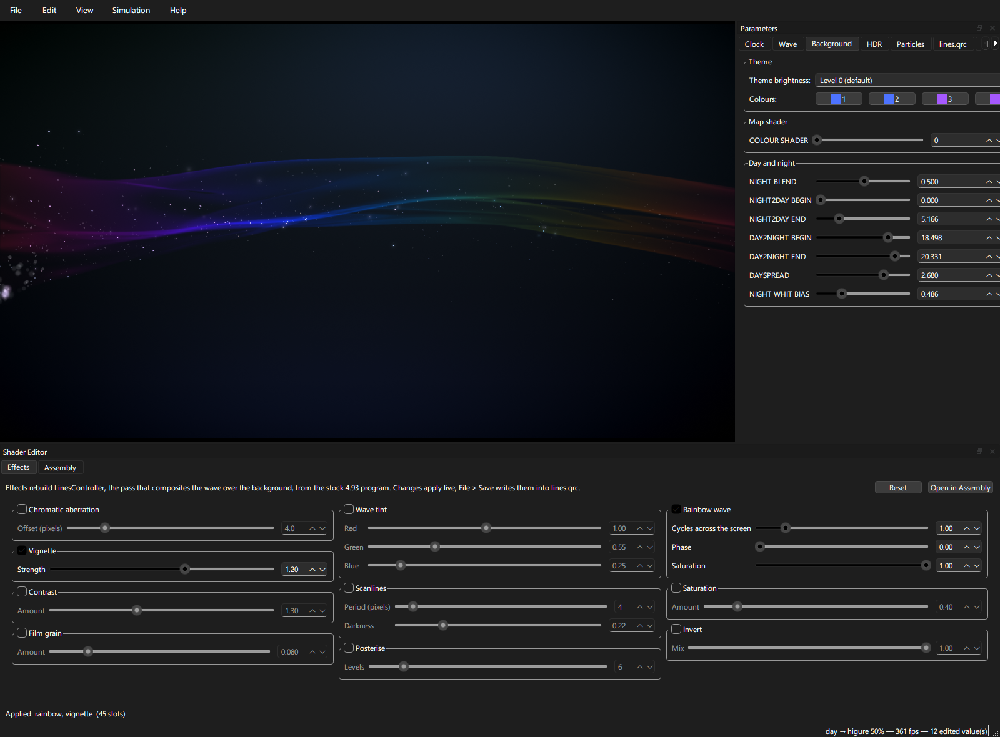

<h1 align="center">moyou</h1>

Make your own PS3 wave.

moyou is a theming tool for the wave behind the PS3's XMB. Open the wave file from your firmware and you get the real thing on screen, moving just as it does on the console, with every part of it yours to change: the colours for each time of day, the shape and motion of the wave, the background, the glow, the sparkles. Add effects like a rainbow wave, scanlines, film grain or a vignette with a tick box. Every change shows up instantly, so you can see the result before you go anywhere near your console.

When you're happy, save it and install it into RPCS3 to test with one click, or copy it to a PS3 that can write to its flash (HEN or CFW).

> [!WARNING]
> **`lines.qrc` lives in your PS3's system flash.** A broken or wrong one can stop the XMB from loading. Try every theme in RPCS3 first, keep the original file somewhere off the console, only use the `lines.qrc` of the firmware your console runs, and know how to reinstall the firmware from Recovery Mode before you need it. moyou comes with **no warranty**: you use it at your own risk, and the author is not responsible for broken themes, lost data or consoles that no longer boot to the XMB.

## Getting started

1. Download moyou from the releases page.
2. Open `lines.qrc`. It lives in `dev_flash/vsh/resource/qgl/` of firmware 4.93. If you wish to use RPCS3 for testing, File > Open from RPCS3 finds it for you.
3. Change things, then File > Save or File > Install to RPCS3.

moyou keeps your original file as `lines.qrc.orig` the first time you save over it. Keep a copy of it before putting a modified wave on a real console.

No Sony files come with moyou; it works on your own. You need a graphics card with OpenGL 4.3, and on Windows the [Microsoft Visual C++ Redistributable](https://aka.ms/vs/17/release/vc_redist.x64.exe) (most PCs already have it).

## More

- [docs/USAGE.md](docs/USAGE.md): everything in the window, the effects and the shader editor
- [docs/BUILDING.md](docs/BUILDING.md): building it yourself
- [docs/INTERNALS.md](docs/INTERNALS.md): how it works, for contributors

## Disclaimer

moyou is an independent project. It is not affiliated with, endorsed by, or derived from Sony Interactive Entertainment. It ships no Sony code or data and only works on files you supply yourself.

"PlayStation", "PS3" and "XMB" are trademarks of their respective owners, used here only to identify the hardware and software moyou works with.

## Licence

MIT. The libraries in the Windows release are listed in [THIRD-PARTY-NOTICES.md](THIRD-PARTY-NOTICES.md).